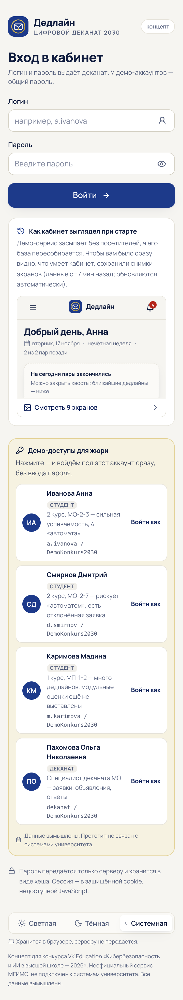
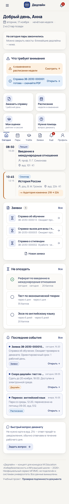

# «Дедлайн» — Цифровой деканат 2030

Рабочий прототип личного кабинета студента **МГИМО** для конкурса **«Кибербезопасность и ИИ в высшей школе — 2026»** (VK Education).

> ⚠️ **Это концепт для конкурса, а не официальный сервис.** Прототип не подключён к системам университета,
> логотип вуза не используется, все ФИО, оценки, номера зачёток и контакты вымышлены.

## Что в кабинете

| Раздел | Что умеет |
|---|---|
| **Вход и профиль** | вход по логину/паролю, демо-доступы в один тап, ФИО, факультет, направление, курс, группа, контакты деканата, смена пароля, 2FA-прототип, выход на всех устройствах |
| **Сегодня** | лента «что важно прямо сейчас»: следующая пара с обратным отсчётом, изменения расписания, ближайшие дедлайны-чекбоксы, статусы заявок, последние события |
| **Расписание** | сегодня / неделя (чётная-нечётная), переносы, отмены, смены аудитории — с автором и временем правки; экспорт в календарь `.ics` |
| **Учёба (успеваемость)** | накопительный рейтинг по дисциплинам, **прогноз «автомата» по регламенту МГИМО (≥ 70 %)**, контрольные точки, сессия, академический рейтинг в потоке, шкала оценок |
| **Заявки и справки** | каталог из 7 услуг, форма → проверка → подача, номер `ЗВ-2030-…`, прогноз готовности (рабочие дни), статусы, отмена, **PDF-справка с QR-подписью** |
| **Уведомления** | изменения расписания, оценки, статусы заявок, объявления деканата, дедлайны, вопросы в деканат |
| **Кабинет деканата** | обработка заявок (в работу / готово / отклонить с причиной), ответы на вопросы, публикация объявлений |




## Тестовые аккаунты (общий пароль `DemoKonkurs2030`)

| Роль | Логин | Кто это |
|---|---|---|
| Студент | `a.ivanova` | Анна Иванова, 2 курс МО, «Дипломатия и политика зарубежных стран», МО-2-3 — сильная успеваемость, есть готовая справка и заявки в работе |
| Студент | `d.smirnov` | Дмитрий Смирнов, 2 курс МО, МО-2-7 — часть дисциплин в зоне риска, отклонённая заявка с причиной |
| Студент | `m.karimova` | Мадина Каримова, 1 курс МП, МП-1-2 — много дедлайнов, оценки модуля ещё не выставлены |
| Сотрудник деканата | `dekanat` | Ольга Пахомова, специалист деканата МО — заявки, вопросы, объявления |

На экране входа есть кнопки «Войти как» — можно войти без ручного ввода.

## Запуск

Требуется Node.js 20+.

```bash
npm install
npm run build          # фронт (Vite) + сервер (tsc)
npm start              # http://localhost:8080 — при первом запуске база наполнится демо-данными
# или для разработки:
npm run dev:server     # API на :8099
npm run dev:web        # Vite на :5173 (проксирует /api)
```

Пароли демо-аккаунтов по умолчанию — `DemoKonkurs2030`, меняется переменной `DEMO_PASSWORD`.
Все секреты — только в переменных окружения, см. `.env.example`. Деплой: [`deploy/README.md`](deploy/README.md), `Dockerfile`, `render.yaml`.

## Как это проверяется

```bash
npm test -w server            # 31 тест: аутентификация, IDOR, троттлинг, PDF, контракт
node scripts/doctor.mjs URL   # API живого сервиса: вход, данные, отказ в доступе к чужим ресурсам
node scripts/smoke.mjs URL    # браузерный сценарий: вход, навигация, заявка, 360 px, клавиатура
```

## Безопасность (кратко)

- Пароли — bcrypt (cost 11), в базе нет открытых паролей.
- Сессия — серверная, в cookie `HttpOnly`, в базе — только SHA-256 токена; в проде `Secure` + `__Host-`.
- **Любой ресурс проверяется на сервере по владельцу** — чужую заявку/PDF нельзя открыть по номеру в адресе (404).
- Троттлинг входа (10 попыток / 15 минут), CSP, `X-Frame-Options: DENY`, проверка `Origin` для не-GET.
- PDF-справки подписаны HMAC-SHA256, публичная страница `/verify/:token` проверяет подлинность без раскрытия персональных данных.

Подробно — [`docs/SECURITY.md`](docs/SECURITY.md).

## Как создавался проект ИИ-ассистентами

- [`docs/PROCESS_LOG.md`](docs/PROCESS_LOG.md) — журнал процесса, ошибки ИИ и исправления.
- [`AGENTS.md`](AGENTS.md) — правила для ИИ-агентов; [`docs/agents/`](docs/agents) — брифы для агентов-бэкендера и агента-фронтендера.
- [`docs/SPEC.md`](docs/SPEC.md), [`docs/DESIGN.md`](docs/DESIGN.md), [`docs/DATA.md`](docs/DATA.md) — спецификация, дизайн-система, модель данных.

## Структура

```
server/   Express 5 + SQLite (better-sqlite3), zod, pdfkit, qrcode; src/contract.ts — контракт API
web/      React 19 + Vite + Tailwind CSS v4; components/ui — дизайн-система
docs/     спецификация, процесс, брифы агентов, материалы разведки, скриншоты
scripts/  doctor.mjs, smoke.mjs, screens.mjs
```

## Лицензии сторонних материалов

React, Vite, Express, zod, pdfkit, Lucide, TanStack Query — MIT/ISC; Tailwind CSS — MIT;
шрифт Manrope — SIL Open Font License (Google Fonts); DejaVu Sans для PDF — свободная лицензия Bitstream Vera/DejaVu.
